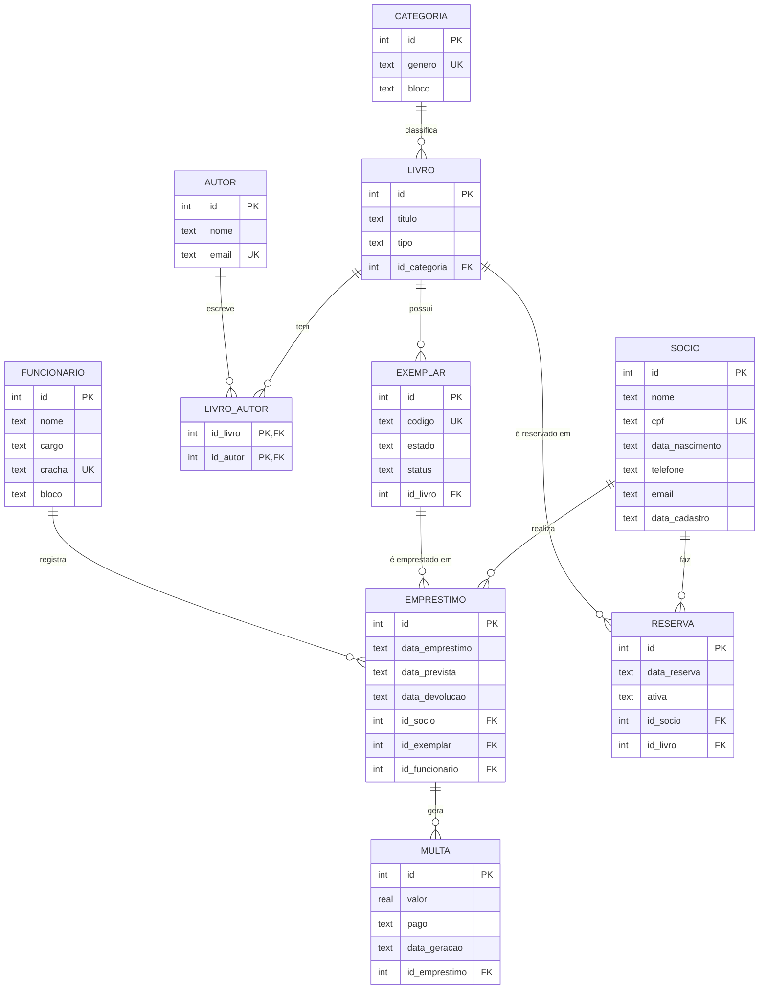

# 📚 Sistema de Gerenciamento de Biblioteca

Sistema de gerenciamento de biblioteca desenvolvido em Python com SQLite, executado diretamente pelo terminal.

  

---

## ✨ O que ele faz

- Lista os livros cadastrados, exibindo título, tipo e categoria.
- Cadastra livros físicos e digitais.
- Cadastra sócios com informações pessoais.
- Registra empréstimos vinculados ao sócio, exemplar e funcionário.
- Registra devoluções e calcula multas por atraso.
- Consulta empréstimos em aberto e identifica atrasos.
- Cadastra funcionários com diferentes cargos.
- Cadastra exemplares de livros físicos.

## 🚀 Como rodar

Precisa apenas do Python 3 instalado. Não é necessário instalar bibliotecas externas.

```bash
python biblioteca.py
```

O banco de dados (`biblioteca.db`) é criado automaticamente na primeira execução, assim como suas tabelas e alguns registros iniciais para teste.

## 📋 Menu

| **Opção** | **Ação** |
|---|---|
| **1** | Listar livros |
| **2** | Cadastrar livros |
| **3** | Cadastrar sócio |
| **4** | Registrar empréstimo |
| **5** | Registrar devolução e gerar multa se houver atraso |
| **6** | Consultar empréstimos em aberto e atrasados |
| **7** | Cadastrar funcionário |
| **8** | Cadastrar exemplar |
| **9** | Sair |

## 💰 Regras de empréstimo e multas

- O empréstimo exige um sócio cadastrado.
- Apenas exemplares físicos em bom estado e disponíveis podem ser emprestados.
- O registro do empréstimo exige o crachá de um funcionário cadastrado.
- A data prevista de devolução não pode ser anterior à data do empréstimo.
- Ao registrar uma devolução atrasada, o sistema calcula uma multa de **R$ 2,00 por dia de atraso**.
- O exemplar volta a ficar disponível após a devolução.

## 🗄️ Banco de dados

O projeto utiliza SQLite e possui 10 tabelas:

| **Tabela** | **Finalidade** |
|---|---|
| `categoria` | Armazena os gêneros e blocos dos livros |
| `livro` | Armazena os livros físicos e digitais |
| `autor` | Armazena os dados dos autores |
| `livro_autor` | Relaciona livros e autores (muitos para muitos) |
| `exemplar` | Controla os exemplares físicos e sua disponibilidade |
| `socio` | Armazena os dados dos sócios |
| `funcionario` | Armazena os funcionários e seus cargos |
| `emprestimo` | Registra os empréstimos e devoluções |
| `reserva` | Armazena os registros de reserva |
| `multa` | Registra os valores das multas e sua situação de pagamento |

## 🧩 Modelo entidade-relacionamento



## 🔎 Consultas de análise

O arquivo [`consultas.sql`](consultas.sql) reúne consultas em SQL (com `JOIN` e `GROUP BY`) para analisar os dados, como livros mais emprestados, empréstimos atrasados, total de multas por sócio, empréstimos por categoria e empréstimos registrados por funcionário.

## 🧠 Competências praticadas

- Python: estruturas condicionais e laços de repetição.
- Manipulação de dados com `input()` e `print()`.
- Tratamento de erros com `try` e `except`.
- Banco de dados relacional com SQLite.
- Criação de tabelas e relacionamentos entre entidades.
- Chaves primárias (PK) e estrangeiras (FK).
- Restrições de integridade (`UNIQUE`, `NOT NULL` e `CHECK`).
- Consultas SQL com `SELECT`, `JOIN`, `GROUP BY` e subconsultas.
- Manipulação de registros com `INSERT` e `UPDATE`.
- Exclusão em cascata com `ON DELETE CASCADE`.
- Consultas parametrizadas (`?`).
- Controle de transações com `commit()`.
- Cálculo de datas utilizando funções do SQLite.


---

Projeto desenvolvido para praticar Python, SQL e modelagem de bancos de dados relacionais.
